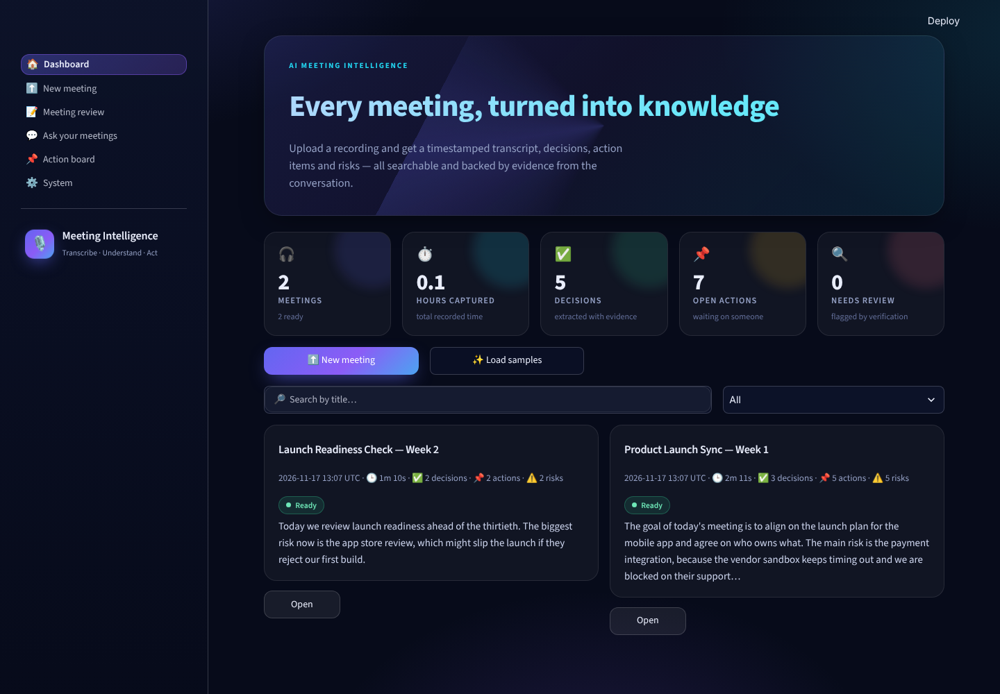
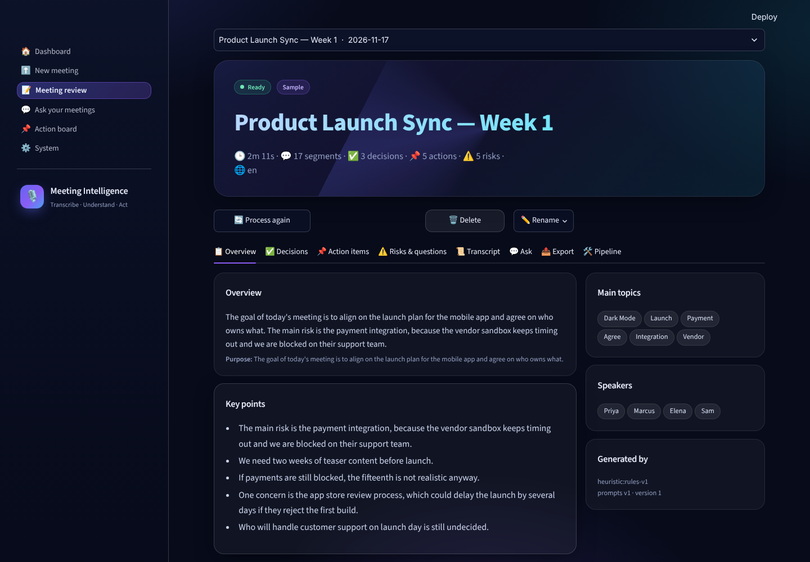
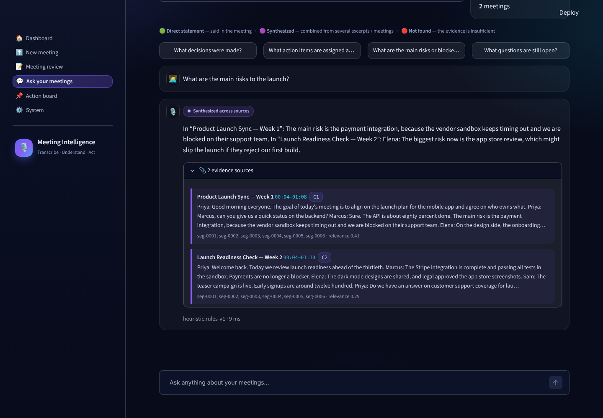
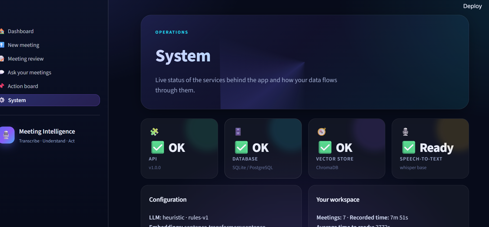

# 🎙️ AI Meeting Intelligence Agent

Turn meeting recordings into **searchable, structured, evidence-linked knowledge** — transcript, summary, decisions,
action items, risks, and a RAG chatbot that answers only from what was actually said.
## Screenshots





Built from the PRD v1.0: **FastAPI · Streamlit · Faster-Whisper · LangChain · LangGraph · ChromaDB · SQLAlchemy (SQLite → PostgreSQL)**.

```
Streamlit UI ─► FastAPI ─► background job ─► LangGraph pipeline
                                 ingest → transcribe → diarize? → chunk → extract → validate → verify → persist → index
                         SQLite/PostgreSQL (source of truth)  +  ChromaDB (vectors)  ─► RAG chatbot
```

## Quick start (VS Code)

Requires **Python 3.10+**. (ffmpeg is *not* required; audio decoding uses PyAV, bundled with faster-whisper.)

```bash
# 1. open the folder in VS Code, then in the integrated terminal:
python -m venv .venv
.venv\Scripts\activate            # Windows      |   source .venv/bin/activate   (macOS/Linux)

# 2. install
pip install -r backend/requirements.txt -r frontend/requirements.txt
pip install -r backend/requirements-ml.txt      # Faster-Whisper + Sentence-Transformers (large download, needed for real audio)

# 3. configure
copy .env.example .env            # (cp on macOS/Linux) – add GROQ_API_KEY for best AI quality

# 4. run both services
python run.py
```
* App → http://localhost:8501  · API docs → http://127.0.0.1:8000/docs
* Or use VS Code ▶ **Run and Debug → "API + UI"**, or `scripts/setup.bat` / `scripts/setup.sh` for steps 1–3.

### Try it without audio, keys or model downloads
Click **✨ Load samples** on the dashboard. Two demo meetings are processed end-to-end so you can explore summaries,
evidence, the action board and cross-meeting Q&A immediately. Without `GROQ_API_KEY` (and without `requirements-ml.txt`) the app
runs in an **offline mode** (rule-based analyser + hashing embeddings): fully functional, but lower quality than a real LLM
and neural embeddings. The System page shows what is active.

## What's implemented (PRD traceability)

| PRD | Feature | Where |
|---|---|---|
| FR-01 | MP3/WAV/M4A upload: extension + magic-byte + decodability checks, size limit, server-generated storage names, unique IDs | `services/storage.py` |
| FR-02 | Faster-Whisper timestamped segments, VAD, progress, model-size/device config | `services/transcription.py` |
| FR-03 | Optional pyannote diarization; uncertain/overlapping turns → `Unknown`; manual speaker naming and per-segment correction | `services/diarization.py`, meeting page |
| FR-04–07 | Summary (overview/purpose/topics/key points/outcome), decisions, action items (owner/due left blank unless stated), risks, blockers, open questions — all with evidence refs | `prompts.py`, `services/extraction.py` |
| FR-08 | RAG chatbot with citations (meeting, timestamps, speakers, excerpt) and explicit "not found" abstention | `services/rag.py` |
| FR-09 | Cross-meeting memory limited to authorised meetings; *direct* vs *synthesized* answers labelled | `services/rag.py` |
| FR-10 | Claim verification: lexical+semantic score, LLM second opinion, conflict detection; unsupported owners/dates are removed; items flagged for review | `services/verification.py` |
| FR-11 | Edit/mark-reviewed items, versioned summary edits, export to **Markdown and PDF** | `api/routes/items.py`, `services/export.py` |
| FR-12 | Dashboard with KPIs, live status, search/filter | `frontend/pages/dashboard.py` |
| §11.3 | LangGraph graph with conditional edges (retry extraction on weak evidence, transcript still indexed if the LLM fails) | `services/pipeline.py` |
| §12 | Overlapping timestamp-aware chunks, deterministic chunk IDs, idempotent delete-then-upsert indexing, hybrid rerank | `chunking.py`, `indexing.py`, `vectorstore.py` |
| §13 | Background jobs, queued/processing/completed/failed + progress, retries with backoff, env config, versioned prompts/schemas, per-stage latency/provider/token metrics | `jobs.py`, `processing_events` table |
| §14 | Optional JWT multi-user mode; every query scoped to the owner (404 on others' data); secrets only in env; no paths/secrets in responses; no transcript text in logs; consent checkbox before sending text to an external LLM; `ALLOW_EXTERNAL_LLM=false` kill-switch | `api/deps.py`, tests |
| §15 | Metrics: WER, DER, precision/recall/F1, Recall@K, MRR, citation accuracy + CLI harness | `app/evaluation/` |
| §16 | Dockerfiles + compose, health endpoint, structured logs (`ENVIRONMENT=production` → JSON) | `docker-compose.yml` |

### API (all PRD routes + extras)
`GET /` · `GET /health` · `POST /meetings/upload` · `GET /meetings` · `GET /meetings/{id}` · `POST /meetings/{id}/transcribe` ·
`GET /meetings/{id}/transcript` · `GET /meetings/{id}/summary` · `POST /chat` · `PATCH /action-items/{id}` · `DELETE /meetings/{id}`
plus `/meetings/demo`, `/meetings/{id}/export|audio|events|reindex`, `PATCH` for segments/speakers/decisions/risks/summary,
`GET /action-items`, `/stats`, `/feedback`, `/auth/*`. Errors always look like `{"error": {"code", "message", "details?"}}`.

## Decisions taken for the PRD's open questions (Appendix B)
| Question | Choice (all changeable via `.env`) |
|---|---|
| Single-user or auth? | Single local user by default; `AUTH_ENABLED=true` turns on register/login (JWT) with per-user isolation |
| LLM provider | Groq (`llama-3.3-70b-versatile`) via OpenAI-compatible API; OpenAI or any compatible server (Ollama, vLLM…) also supported; offline fallback if no key |
| Whisper size | `base` (CPU-friendly). Use `small`/`medium` for accuracy, `tiny` for speed, `large-v3` with a GPU |
| Diarization in MVP? | Optional, off by default (`DIARIZATION_ENABLED=true`, `pip install -r backend/requirements-optional.txt`, `HF_TOKEN`) |
| Retention/deletion | User-initiated delete removes audio, transcript, notes and vectors. No automatic expiry in the MVP |
| Export | Both Markdown and PDF |

## Configuration highlights (`.env`)
`GROQ_API_KEY` · `LLM_PROVIDER` · `WHISPER_MODEL_SIZE` · `EMBEDDING_BACKEND` (`sentence-transformers`|`hash`) · `AUTH_ENABLED` ·
`MAX_UPLOAD_MB` · `DATABASE_URL` (e.g. `postgresql+psycopg://…`, also `pip install psycopg[binary]`) · `DATA_DIR`. See `.env.example`.

## Tests & evaluation
```bash
cd backend && pytest                                   # 39 tests: uploads, auth isolation, pipeline, RAG, export, units
python -m app.evaluation.run --dataset ../docs/eval_sample.json   # extraction P/R/F1 + Recall@K/MRR with your configured models
```
Tests run fully offline (fake transcriber, rule-based LLM, hashing embeddings).

## Docker
```bash
cp .env.example .env && docker compose up --build      # UI :8501, API :8000, data in the meeting_data volume
```
(`--build-arg INSTALL_ML=false` in `backend/Dockerfile` for a slim image.)

## Project layout
```
backend/app/{core,db,schemas,services,api/routes,evaluation}   backend/tests
frontend/{app.py, pages/, theme.py, api_client.py, common.py}
docs/{ARCHITECTURE.md, eval_sample.json}   run.py   docker-compose.yml   .env.example
```

## Known limitations / next steps
* Jobs run in an in-process thread pool; swap `services/jobs.py` for Celery/RQ when scaling out (PRD §16.1). Jobs interrupted by a restart are marked failed and can be re-run.
* Schema is created with `create_all`; add Alembic migrations before moving to PostgreSQL in production.
* Real-audio quality (WER/DER) depends on your hardware, model size and recordings — run the evaluation harness on your own dataset.
* Use HTTPS (reverse proxy) and a strong `JWT_SECRET` in any shared deployment.
